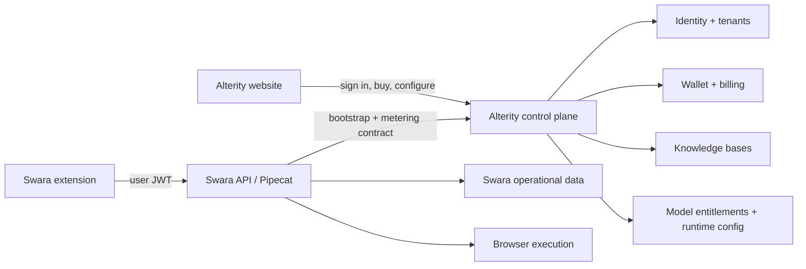

# Alterity ↔ Swara product bridge

Status: Swara-side contract and bootstrap scaffold implemented; Alterity remains
read-only during this phase.

## Product decision

Swara is an Alterity subproduct, not a second platform and not an Alterity UI
module. Alterity is the commercial and administrative control plane. Swara is
an independently deployable browser/voice execution plane.

This gives us one customer account, workspace, bill, wallet, provider catalogue,
knowledge estate, and audit vocabulary while keeping a failure or release in
Swara from taking down Alterity's core voice product.



## What we reuse

The current Alterity repository already provides these reusable primitives:

| Concern | Existing Alterity primitive | Swara use |
|---|---|---|
| Identity | Supabase Auth plus `users` | One login and user ID |
| Tenancy | `clients`, `sub_clients`, `user_sub_client_access` | Workspace and branch scope |
| Product access | `tenant_features` | `swara` and capability entitlements |
| Limits | `tenant_limits` | Sessions, concurrency, OCR, steps, voice |
| Billing | Wallet balance, rate cards, rate snapshots | One Alterity bill and wallet |
| Models | Model tiers, overrides, runtime config | Shared STT/TTS/LLM policy |
| Knowledge | `knowledge_bases`, `knowledge_documents`, `knowledge_chunks` | Reference the same indexed content |
| Document parsing | AnyDoc local conversion plus OCR fallback | Local-first ingestion and lower OCR cost |
| Audit | `audit_log` and semantic audit actions | Unified product audit history |

Swara must not copy these rows into a parallel account/billing database. It may
cache a short-lived bootstrap lease, but Alterity remains the system of record.

## What stays isolated

Swara owns operational data that has no natural home in Alterity:

- browser sessions, task plans, steps, retries, and confirmations;
- DOM snapshots and page-derived artifacts with short retention;
- extension devices and encrypted device-session metadata;
- workflow definitions and browser-specific policy decisions;
- execution traces, latency, safety interventions, and replay metadata;
- Swara-specific context items that reference, rather than duplicate, an
  Alterity knowledge base.

Use a dedicated `swara` Postgres schema or explicitly prefixed private tables.
Do not expose operational tables through the Data API by default. If a table is
intentionally exposed, enable RLS, revoke default grants, grant only required
operations, and test owner, worker, cross-tenant, anonymous, and service paths.

## Control-plane contract

Swara talks to one Alterity-owned Supabase Edge Function configured through
`ALTERITY_CONTROL_PLANE_URL`. The current client sends an action envelope so we
can ship one independently versioned function before splitting endpoints later.

### Bootstrap

`POST {ALTERITY_CONTROL_PLANE_URL}` with the user's Supabase access token:

```json
{
  "action": "bootstrap",
  "product": "swara"
}
```

Alterity validates the JWT, resolves `users.client_id` and role from the
database, checks `tenant_features`, and returns:

- principal and tenant identity;
- allowed sub-clients;
- Swara plan, capabilities, limits, and expiry;
- wallet snapshot and currency;
- knowledge-base references the tenant may read;
- effective STT/TTS/LLM models and runtime routing;
- a short lease expiry.

Never derive tenant or role from editable user metadata. Swara also must not
accept `client_id` from the extension as authoritative.

### Billing lifecycle

Every paid operation follows an idempotent three-state lifecycle:

1. `reserve_usage` before spending money or scarce provider capacity.
2. `commit_usage` with the actual measured quantity after completion.
3. `release_usage` when the operation never became billable.

The Swara server authenticates these operations with
`ALTERITY_SWARA_SERVICE_TOKEN`; this credential is never packaged in the
extension. Every mutation carries `Idempotency-Key`, and Alterity enforces a
unique `(product, event_id, operation)` or equivalent database constraint.

Supported initial meters are browser session, browser step, voice second, LLM
input token, LLM output token, and OCR page. Swara reports quantity; Alterity
selects the rate card and computes price. A client must never submit its own
price or discount.

Reservations prevent four expensive failure modes: duplicate browser runs,
provider spend after balance exhaustion, double charging on retries, and charging
for a session that failed before execution.

## Authentication flow

1. The extension opens an Alterity-hosted authorization page using a Chrome
   identity/PKCE flow.
2. Alterity completes Supabase Auth and returns only the authorization result to
   the extension redirect URL.
3. The extension keeps session material in extension-owned storage and sends the
   short-lived access token to Swara over TLS.
4. Swara calls `bootstrap`; Alterity validates the token using Auth/JWKS and
   resolves tenancy server-side.
5. Swara starts work only when `entitlement.enabled` is true and the lease is
   valid.

Use asymmetric Supabase signing keys and JWKS verification where available.
Do not ship a service-role or shared JWT secret to either Alterity's browser UI
or the extension.

## Knowledge and Vault strategy

There should be one tenant knowledge estate. Alterity owns the durable KB,
embedding model, chunks, ingestion job records, and private temporary originals.
Swara's Vault is another client of that estate.

- Reuse Alterity's KB IDs; do not copy chunks into Swara tables.
- Run AnyDoc in the extension for readable documents.
- Send extracted Markdown through Alterity's existing tenant-scoped ingestion
  path.
- Invoke OCR only for scanned, mixed-unreadable, image, or damaged inputs.
- Keep originals private and temporary; use signed upload URLs.
- Keep embedding model and dimensions identical between ingest and retrieval.
- Store a Swara context reference as `(client_id, user_id, kb_id, source_id)`.

This removes duplicate storage, parsing, embeddings, and OCR spend while making
the same knowledge available to Alterity voice agents and Swara browser tasks.

## Availability and criticality

The integration must fail safely without making Swara unusable during a brief
Alterity outage:

| Condition | Behaviour |
|---|---|
| Valid cached lease, control plane briefly unavailable | Continue the current session within the lease |
| Lease expired | Do not start a new paid operation |
| Entitlement disabled | Stop before execution; link to Alterity billing/settings |
| Low balance | Warn; apply Alterity's policy for whether new work may start |
| Reservation timed out | Retry with the same idempotency key |
| Commit timed out | Retry with the same event and idempotency key; never create a second charge |
| Alterity KB unavailable | Continue only if the requested task does not need KB retrieval |
| Provider unavailable | Route only to an entitled fallback; otherwise release reservation |

Add timeouts, bounded retries with jitter, circuit breaking, correlation IDs,
structured audit events, and a dead-letter reconciliation job before general
availability. Usage reconciliation should compare reservations, provider usage,
commits, and wallet entries every day.

## Cost model

The bridge avoids duplicate fixed and variable costs:

- one Supabase Auth tenant and user directory;
- one customer/organization and sub-client model;
- one billing, wallet, rate-card, invoice, and usage UI;
- one AnyDoc/OCR ingestion path and knowledge index;
- one provider configuration and entitlement catalogue;
- one set of admin, audit, notification, and analytics primitives;
- no second customer portal or subscription lifecycle.

Swara may run a separate API deployment because isolation and independent
scaling are valuable. That is a small execution-plane cost, not a duplicated
platform cost.

## Rollout plan

### Phase 0 — contract and isolation (implemented in Swara)

- Typed bootstrap and metering contracts in `server/alterity_bridge.py`.
- `/platform/status` and authenticated `/platform/bootstrap` routes.
- Standalone mode remains the default when no endpoint is configured.
- Unit tests cover token separation, idempotency, 2xx handling, rejection, and
  fail-closed metering.

### Phase 1 — Alterity control plane

- Add `swara` feature keys and capability config to `tenant_features`.
- Create an Alterity-owned `swara-platform` Edge Function using the shared
  `resolveCaller` pattern.
- Return only tenant-scoped KB references and effective models.
- Add append-only usage reservations/events and an atomic idempotent RPC.
- Extend Alterity Usage and wallet views with a Swara product filter.
- Add a Swara product/settings page and install/open-extension entry point.

No Phase 1 change has been applied to the Alterity repository by this work.

### Phase 2 — extension identity and Vault convergence

- Add PKCE login/logout and session refresh to the extension.
- Bootstrap before opening paid voice/browser sessions.
- Replace Swara's direct service-role Vault access with user/tenant-scoped APIs.
- Point the Vault UI at Alterity KB IDs and its local-first ingestion contract.
- Add workspace and sub-client switching where the user is authorized.

### Phase 3 — production metering and observability

- Reserve/commit/release browser, voice, LLM, and OCR usage.
- Add a reconciliation worker, cost dashboards, alerts, and support tooling.
- Add per-tenant concurrency, spend, retention, domain, and action policies.
- Run RLS, replay, duplicate, token-rotation, outage, and load test suites.

### Phase 4 — unified commercial launch

- Sell Swara plans and add-ons only through Alterity.
- Support bundles: Alterity Voice, Swara Browser, or Alterity Suite.
- Keep the extension thin and free to install; paid capability is server-side.
- Publish the SDK/protocol selectively while retaining hosted execution,
  billing, managed voice, and enterprise policy as the commercial product.

## Immediate Alterity hand-off checklist

The next Alterity change should be a narrowly scoped PR implementing the
contract above, with no Swara operational tables mixed into existing call
tables. Required acceptance tests:

- invalid/expired token returns 401;
- user without `swara` entitlement returns 403;
- worker receives only permitted sub-clients;
- cross-tenant KB identifiers return 404;
- duplicate reserve/commit/release calls return the original receipt;
- price comes exclusively from Alterity's active product rate card;
- insufficient balance rejects before provider work begins;
- all usage transitions and administrative entitlement changes are audited;
- service token cannot call customer-facing actions and user JWT cannot call
  service-only metering actions.

## Supabase compatibility notes (checked 24 August 2026)

- New public tables are no longer automatically exposed through the Data API;
  opt in only where required.
- Supabase JavaScript libraries require Node.js 22 or later.
- Treat any 2xx response as success; do not depend on an OAuth token endpoint
  returning 201.
- Verify user JWTs using Auth/JWKS; do not implement JWT cryptography manually.
- Enable RLS and correct grants on every intentionally exposed table. Views must
  use invoker security when they expose tenant data.
